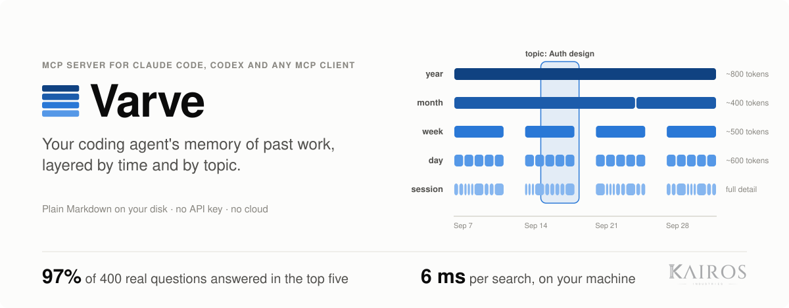
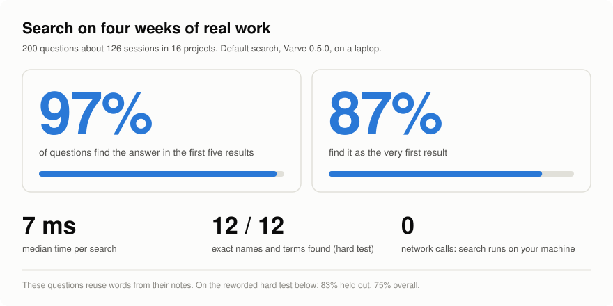
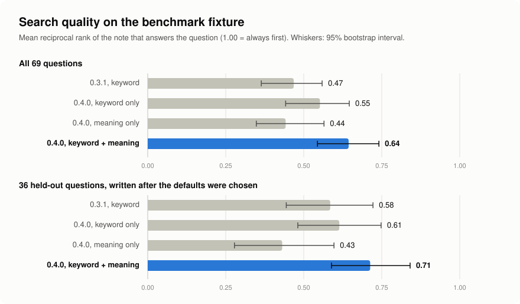
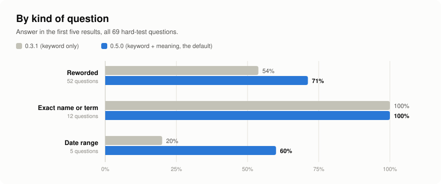
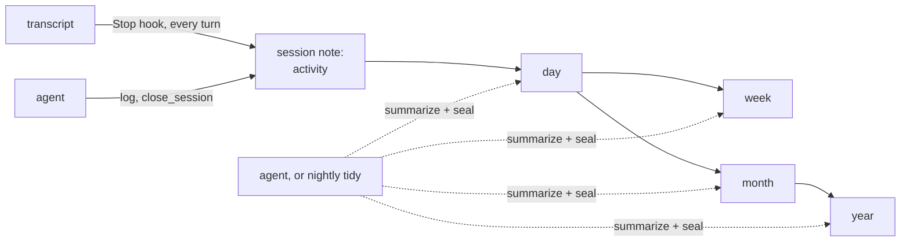

<p align="center">
  <picture>
    <source media="(prefers-color-scheme: dark)" srcset="docs/assets/hero-dark.svg">
    
  </picture>
</p>

<p align="center">
  <a href="https://github.com/pomess/varve/actions/workflows/ci.yml"></a>
  <a href="LICENSE"></a>
  
  
  
</p>

<p align="center">
  <a href="#quick-start">Quick start</a> ·
  <a href="#benchmark">Benchmark</a> ·
  <a href="#how-it-works">How it works</a> ·
  <a href="#what-your-agent-sees">What your agent sees</a> ·
  <a href="#reference">Reference</a>
</p>

https://github.com/user-attachments/assets/d483ee6e-d5b9-4531-af3f-98788f8e92e7

Your coding agent forgets everything when the session ends. Varve gives it a memory of past work.

It is an MCP server that records what you and your agents do in each session, then summarizes that record into day, week, month and year notes, each shorter than the one below. Across those layers it keeps topic notes of what stays true: dated claims, open items, and the claims they replaced. A new session starts with a brief of the project: what happened yesterday, what was decided last week, what is still open. From there the agent can zoom into any period, read a topic, or search everything that came before.

Everything lives in one folder of plain Markdown, the atlas. Open it in Obsidian, edit it by hand, keep it in git.

**Why not CLAUDE.md or a memory file?** Those hold what you or the agent decided to write down: instructions and standing facts. Varve holds what happened, recorded on its own after every turn: dated, kept per project, summarized so the brief stays small however long the history (about 1,000 tokens on average on the author's atlas, 1,700 at most), and searchable when the agent needs more. Claude Code and Codex share the same atlas. The two work together: a memory file says how to work, Varve says what was done and what is still open.

<sub>A varve is one year's layer of sediment at the bottom of a lake; geologists read time by counting them.</sub>

<table>
<tr>
<td width="50%" valign="top"><b>Records every session on its own</b><br>In Claude Code and Codex, hooks write each turn into the session note: what you asked, files changed, commits, PRs. No model call, and the agent doesn't have to remember.</td>
<td width="50%" valign="top"><b>Layered by time and by topic</b><br>Sessions roll up into days, weeks, months and years. Topic notes cut across the layers: each claim says since when it holds and where it came from, and a replaced claim keeps its dates in History.</td>
</tr>
<tr>
<td width="50%" valign="top"><b>Search by keyword and by meaning</b><br>A 30 MB embedding model runs on your machine in plain TypeScript. Asked about &quot;typefaces slowing down the first launch&quot;, it ranks first the note that says fonts were loading on cold start, which keyword search misses.</td>
<td width="50%" valign="top"><b>Plain Markdown you own</b><br>Notes have YAML frontmatter and wikilinks, so Obsidian's graph works without setup. Edit any note and your version wins; the summaries built on it are redone.</td>
</tr>
<tr>
<td width="50%" valign="top"><b>Client work stays apart</b><br>Every project gets its own scope. Isolated scopes never appear in another project's brief or search.</td>
<td width="50%" valign="top"><b>Spends only within a budget</b><br>The server never calls a model. Your agent writes the summaries, or <code>tidy</code> does overnight inside a hard token and dollar cap (about 2 cents a rollup with Sonnet).</td>
</tr>
</table>

## Quick start

Requires Node 20 or later and [Claude Code](https://claude.com/claude-code) or [Codex](https://developers.openai.com/codex).

```sh
npm install -g github:pomess/varve
varve setup
```

`setup` shows what it will change and asks three questions:

1. **Do you work for more than one client on this machine?** If yes (the default), every project starts isolated.
2. **Write the summaries every night?** If yes, a scheduled job runs `varve tidy` at 04:30 with your Claude Code sign-in and stops at $2.00 a night. A laptop that was off at 04:30 catches up at the next login. If no, your agent writes summaries when you ask it to tidy the atlas.
3. **Download the search model?** If yes (the default), it fetches potion-base-8M (about 30 MB, MIT) once from a pinned Hugging Face revision and checks its hashes.

It then creates the atlas in `~/Varve`, registers the MCP server, and adds three hooks (`SessionStart`, `Stop` after every turn, `SessionEnd`) to Claude Code and, if `~/.codex` exists, to Codex. Open a new session in any project and the agent gets its brief. In Codex, run `/hooks` once to trust the new hooks.

```sh
varve doctor      # check the install, the backlog and the search model
varve uninstall   # remove hooks, MCP registrations and the nightly run; your notes stay
```

`setup --yes` takes the defaults without asking and skips the download. `setup --dir <path>` puts the atlas somewhere else, for example `--dir ~/MyVault/Atlas` inside an Obsidian vault. The server writes only inside that folder.

## Benchmark

`varve bench` measures how often search brings back the note that answers a question. It calls no model and only reads the atlas.

<p align="center">
  <picture>
    <source media="(prefers-color-scheme: dark)" srcset="docs/assets/headline-dark.svg">
    
  </picture>
</p>

| Default search (keyword + meaning) | Answer first | Answer in the top five |
|---|---|---|
| Real work: the author's atlas, 400 questions | 83% | 97% |
| Real work, exact names only (200 of the 400) | 82% | 96% |
| Hard test: 36 held-out questions | 61% | 83% |
| Hard test: all 69 questions | 55% | 75% |

The two datasets bracket everyday use:

- **Real work** is built from four weeks of the author's daily work in Claude Code (128 sessions in 17 projects): 177 logged decisions and findings, 200 names that appear in only one note (files, products, identifiers, acronyms), and 23 headlines of sealed day and week summaries. The questions reuse words from their notes, so they flatter search.
- **The hard test** is a bundled atlas of 26 invented sessions in three projects with 69 hand-written questions, the same on every machine. Most are reworded the way a colleague asks weeks later, without the note's distinctive words: "the spreadsheet download we got rid of" for a note about removing the CSV export. The 36 held-out questions were written after the defaults were chosen and never used to tune them.

An agent reads several results and can search again in other words, so "in the top five" is closer to whether it found what it needed than "first".

<p align="center">
  <picture>
    <source media="(prefers-color-scheme: dark)" srcset="docs/assets/search-quality-dark.svg">
    
  </picture>
</p>

<p align="center">
  <picture>
    <source media="(prefers-color-scheme: dark)" srcset="docs/assets/by-kind-dark.svg">
    
  </picture>
</p>

What the numbers say, and what they don't:

- **Names are found.** 96% of 200 names from real work are in the top five, and 12 of 12 on the hard test. Keyword search alone does a little better on names (98%), because matches by meaning can push a name's note down a place.
- **Adding meaning to keyword search helps.** On the same questions it ranks the answer higher on 12 and lower on 5: +0.09 MRR (0.03 to 0.17) on all questions, +0.10 (0.01 to 0.22) on the held-out ones. Meaning alone is worse than keyword alone, so the two are fused.
- **Rewording is the weak spot.** Reworded questions found in the top five rose from 54% in 0.3.1 to 71%: search stopped ranking day and week drafts above the sessions they repeat, and matches by meaning were added. The search model is small (30 MB, no native code); a larger one would likely do better here.
- **Date ranges are too few to judge.** Five questions, three found in the top five.
- **The hard test is small and written by the author**, so treat it as a regression check. Reports from other people's atlases are the real measure: `varve bench` on your own atlas saves a report that holds numbers only, ready to [share](docs/BENCHMARK.md#send-your-results).
- **The brief no longer drops todos.** In 0.4 it showed 0% of the todos logged in the last 14 days unless they were in the last session's open threads. 0.5 adds the Open section: 100% on both datasets, for about 20 to 40 more tokens.

Mean reciprocal rank scores how high the answer ranks: 1.00 when it is always first, 0.50 when it is second on average.

| Mean reciprocal rank (95% interval) | Hard test, all 69 | Hard test, 36 held-out | Real work, 400 |
|---|---|---|---|
| 0.3.1, keyword | 0.47 (0.36 to 0.56) | 0.58 (0.44 to 0.72) | |
| 0.4.0, keyword only | 0.55 (0.44 to 0.65) | 0.61 (0.48 to 0.75) | 0.91 (0.90 to 0.93) |
| 0.4.0, meaning only | 0.44 (0.35 to 0.56) | 0.43 (0.28 to 0.60) | 0.68 (0.65 to 0.73) |
| **0.4.0, keyword + meaning (default)** | **0.64 (0.54 to 0.74)** | **0.71 (0.59 to 0.84)** | **0.89 (0.87 to 0.92)** |

Real work was measured with 0.5.0, whose search is the same as 0.4.0's. On it keyword alone scores a little higher than the default, as expected when the questions reuse the notes' words.

Every number, the threshold sweep, and how to send your results: [BENCHMARK.md](docs/BENCHMARK.md).

## Size and cost: the first 12 days

From the first 12 days of the author's own atlas (8 to 20 October 2026, before the benchmark above): 11 scopes and 57 recorded conversations.

| Measure | Result |
|---|---|
| Conversation text in those 57 conversations (tool output excluded) | about 1.25 million tokens |
| The same conversations as activity, recorded without a model | about 26,000 tokens, **49x smaller** |
| Activity per conversation per day | about 380 tokens |
| Sessions the agent summarized itself, against their conversation text | 36x smaller |
| Brief for the busiest project | about 1,600 tokens, built in under 100 ms |
| Model calls made by the MCP server | 0 |
| Day and week summaries written by `tidy` (Sonnet, 6 rollups) | 6 of 6 sealed, $0.13 in total |
| Test suite today | 161 tests on macOS, Linux and Windows, none call a model |

Token counts are estimated at 4 characters per token, the same rule the server uses for its cost gate. Version 0.2 came out of these 12 days: see [what changed and why](docs/DESIGN.md#18-what-v02-changed-and-why).

## How it works



| Layer | Example | Length | Holds |
|---|---|---|---|
| year | `2026` | ~800 tokens | what the year was about |
| month | `2026-10` | ~400 tokens | what shipped, what changed direction |
| week | `2026-W42` | ~500 tokens | the week's arc |
| day | `2026-10-19` | ~600 tokens | what got done, decided, left open |
| session | `2026-10-19T0907-k3f9q2` | full detail | requests, files, commits, decisions, findings |

**Activity.** After every turn, the `Stop` hook reads what the transcript gained and rewrites the session's `### Activity` section. It takes milliseconds and calls no model, because only the new part of the transcript is read. Tool output is never copied. A conversation you reopen keeps writing to the same note.

```markdown
### Activity
Invoice PDF rendering queue

- 09:07 asked: Move invoice PDF rendering off the request path, it times out on big invoices
- 10:31 asked: make the retries idempotent
- files changed (3): `src/render/queue.ts`, `src/render/worker.ts`, `test/render.test.ts`
- 11:02 commit: Render invoice PDFs from a queue with idempotent retries
- 11:03 pushed (origin main)
- 11:04 last reply: Pushed. Rendering runs on the queue now; a retry with the same invoice_id and version is a no-op...
- 3 requests, 41 tool calls
```

**Events and summaries.** As it works, the agent calls `log` for each decision (with the reason), notable change, finding or todo, and `close_session` before it finishes. These carry the why, which activity can't. A session that runs past the day boundary (04:00 by default) is split per day, so late-night work counts toward the day it belongs to.

**Drafts.** While a period is open, the server assembles its note from the notes beneath it. Drafts cost no tokens and grow in Obsidian as you work.

**Rollups.** When a period ends it becomes a pending rollup. Your agent (through `summarize` and `seal`) or `varve tidy` reads its sources, writes a summary to a length target, and seals it. The server rejects a summary longer than 150% of its target. Days roll up into both weeks and months, because ISO weeks cross month boundaries.

**Cost control.** The server estimates the input tokens of every pending rollup. An agent runs rollups under the cost gate (30,000 tokens by default) without asking, and above it must tell you the estimate and wait for a yes. `tidy` runs inside its own token and dollar budget and logs each rollup with its cost.

### Topics: what stays true

The layers answer "what happened, and when". Topic notes answer "what do we know about X, since when, and what is still open". Each line is a claim or an open item with the day it started, the note it came from, and an Obsidian block id:

```markdown
# Auth design

## What we know now
- Enterprise users sign in through Okta with SAML. (since 2026-09-09, [[2026-09-09T1000-jmsz2o]]) ^c1jbzav

## Open
- Decide the session lifetime for SAML users. (open since 2026-09-09, [[2026-09-09T1000-jmsz2o]]) ^oe5vw95

## History
- ~~Everyone signs in with magic links.~~ (since 2026-09-01, until 2026-09-09, replaced by ^c1jbzav) ^cdise4w
```

Rollups write them. The writer of a day, week or month note sees the scope's current claims and open items with their ids, and adds claims, replaces or closes them by id, opens items, and resolves them. The server checks every id and day before it seals anything, and nothing is deleted: a replaced claim or a resolved item moves to History with the day it ended. An agent can do the same during a session with the `topic` tool, citing that session. The server checks for similar topic names first, so you don't end up with "Auth", "Authentication" and "Auth design".

The brief carries the result: an **Open** section (open items from topics, and todos from the last two weeks that no rollup has read yet) and a **Changed this week** section.

## What your agent sees

At the start of every session the agent receives a brief of its project. A shortened example:

```markdown
# Varve brief: billing-api
Today is Tue 2026-10-20, week 2026-W43. Days end at 04:00 local time.

## Last session (2026-10-19)
Moved invoice PDF rendering to a queue; retries now idempotent

#### Decisions
- Kept the existing S3 bucket; a new one would need a security review (2 weeks).
- Retry key is invoice_id + version, so a re-render after an edit is not deduplicated.

#### Open threads
- Load test with 10k invoices before Thursday's release.
- Ask Dana whether credit notes need the same queue.

## This week (draft)
- Mon 10-19: invoice rendering queue, idempotent retries
- Tue 10-20: (today)

## Last week: 2026-W42
Shipped proration for mid-cycle plan changes. Found and fixed a rounding bug in
EUR invoices (banker's rounding vs half-up). Decided to drop the legacy CSV export.

## Open
- Load test with 10k invoices before Thursday's release. (logged 2026-10-19)
- Decide whether credit notes need the same queue. (since 2026-10-14, [[Invoicing]])

## Changed this week
- [[Invoicing]]: Invoice PDFs render on a worker queue.
- [[Invoicing]]: replaced: Invoice PDFs render in the request.

## Elsewhere this week
- **payments-gateway**: Stripe webhook signature check moved to middleware
```

When it needs more, it asks. "What did we decide about the CSV export?" runs `search`. "What happened in September?" runs `zoom`.

| You say | The agent calls |
|---|---|
| "What were we doing on this?" | `brief` |
| "What did we decide about the CSV export?" | `search` |
| "Show me what happened in September." | `zoom` with `2026-09` |
| "Tidy the atlas." | `pending`, then `summarize` and `seal` for each rollup |
| "Keep this project hidden from the others." | `scopes` with `isolated` |
| "This session is client-x work." | `log` with `scope: "client-x"`, which moves the session |
| "That summary is wrong, we never dropped the export." | `amend` |
| "What do we know about auth?" | `topic` |
| "When did we switch to Okta, and why?" | `topic`, then `zoom` on the day its History line names |

## Privacy and security

- The atlas stays on your disk. The MCP server and the hooks make no network calls.
- `tidy` sends rollup sources to a model through your own `claude` CLI, only when you run or schedule it.
- The search model is downloaded once, from a pinned revision whose file hashes are checked. Search runs on your machine.
- Before writing any note, the server replaces likely secrets with `[redacted:<kind>]`: Anthropic, OpenAI, GitHub, Slack and AWS keys, bearer tokens, private key blocks, passwords in connection strings, `secret=`-style assignments, and patterns you add.
- Activity keeps short excerpts of requests and replies (300 and 600 characters at most), never tool output.
- `bench` reports hold numbers, the version, the platform and the model id. A test fails if a report ever contains note text or a project name. `bench --paraphrase` sends only the probe queries to a model, after asking.

## Reference

<details>
<summary><b>Other MCP clients</b></summary>

Cursor, Windsurf, VS Code and other MCP clients can use every tool. They don't get automatic capture, so the atlas holds what the agent logs and summarizes. Create the atlas with `varve init ~/Varve`, then add the server:

```json
{
  "mcpServers": {
    "varve": {
      "command": "varve",
      "env": { "VARVE_DIR": "/Users/you/Varve" }
    }
  }
}
```

The server uses only tools, no MCP resources or prompts, so it behaves the same in every client. Clients that don't read server instructions, such as VS Code Copilot, can call `brief` to get the same context.

</details>

<details>
<summary><b>Updating and installing from source</b></summary>

Run the install command again. It replaces the code in place, and the hooks and the MCP server keep pointing at it:

```sh
npm install -g github:pomess/varve          # latest
npm install -g github:pomess/varve#v0.4.0   # a tagged version
```

From an earlier version, run `varve setup` again, then `varve doctor`, which names anything else to run. Varve was called Temporal Atlas until 0.5: setup replaces the `temporal-atlas` MCP registration, and the old command, `TEMPORAL_ATLAS_*` variables and an existing `~/TemporalAtlas` folder keep working.

The package is installed straight from GitHub and is not on the npm registry. To work on it:

```sh
git clone https://github.com/pomess/varve.git && cd varve
npm install
node dist/cli/main.js setup
```

Run `npm run compile` after you change the code. The server and the hooks run whatever is in `dist/`.

</details>

<details>
<summary><b>Projects and client isolation</b></summary>

Every session belongs to a scope, usually one project or one client. The server picks the scope in this order:

1. A rule you saved with `scopes` (`mapHere`) for this folder or git remote.
2. `general`, for folders inside `capture.generalPaths`, such as the scratch folders Claude Desktop creates for each chat.
3. The repository name from the `origin` git remote.
4. The git root folder name.
5. The working directory name.
6. `general`, for sessions outside any project (including your home directory).

A scope marked isolated is visible only from sessions inside it. It never appears in another project's brief, in search results or in index notes, even if an agent asks for it by name. With `isolateNewScopes` on (the `setup` default), every new project starts isolated.

| From a session in | Can read |
|---|---|
| an isolated scope X | X and `general` |
| any other scope | itself, `general`, every non-isolated scope, index notes |

A scope follows the folder you start in, not the client you work for. If you prepare one client's workshop from another project's folder, tell the agent ("this is client-x work") and it calls `log` with that scope. The session note moves, and the hooks keep writing there. `scopes` can also merge one scope into another; merging into an unused name is a rename.

</details>

<details>
<summary><b>What is not recorded</b></summary>

- Headless sessions: `claude -p`, `codex exec`, SDK runs and subagents, where every prompt came from a program. Set `capture.headless` to record them.
- Sessions in folders listed in `capture.ignorePaths`.
- The `claude -p` calls that `tidy` makes.

</details>

<details>
<summary><b>Your edits win</b></summary>

The server stores a hash of every note body it writes. If the body on disk no longer matches, a person edited it. The server keeps that version, never overwrites it, and marks every summary built on it stale. Stale summaries go back into the rollup queue. Agents correct sealed notes with `amend`, which adds a dated entry with its reason and leaves the original text in place.

</details>

<details>
<summary><b>Tools</b></summary>

| Tool | Arguments | Does |
|---|---|---|
| `brief` | `scope?`, `lookback?` | The layered view of recent work in a scope |
| `log` | `type`, `text`, `topics?`, `scope?` | Records a decision, change, finding, todo or note |
| `close_session` | `headline`, `summary`, `segment?` | Writes the session summary and returns pending rollups |
| `pending` | `all?` | Lists pending rollups with token estimates, each marked `auto` or `needs_confirmation` |
| `summarize` | `period`, `scope?`, `confirmed?` | Returns the sources, length target and instructions for one rollup |
| `seal` | `period`, `content`, `headline`, `scope?`, `topic_updates?` | Saves a rollup and seals the period |
| `zoom` | `period`, `scope?` | Opens a period or session and lists the notes beneath it |
| `search` | `query`, `scope?`, `layer?`, `from?`, `to?` | Search by keyword and by meaning, filtered by scope, layer and date. Each result says how it matched. |
| `topic` | `name`, `scope?`, `update?`, `force?` | Reads, creates or updates a topic note |
| `scopes` | `set?` | Lists scopes, or isolates, maps or merges one |
| `amend` | `note`, `change`, `reason` | Adds a dated correction to a sealed note |

</details>

<details>
<summary><b>Command line</b></summary>

```
varve                      Run the MCP server over stdio
varve setup                Set up Claude Code and Codex (asks first; --dir, --isolate, --no-isolate, --nightly, --yes)
varve uninstall            Remove the hooks, the MCP registrations and the nightly run; keeps your notes
varve init [dir]           Create an atlas (default: $VARVE_DIR or ~/Varve)
varve install claude-code  Add the capture hooks to ~/.claude/settings.json (asks first; --yes to skip)
varve install codex        Add the capture hooks to ~/.codex/hooks.json (asks first; --yes to skip)
varve install nightly      Schedule `tidy --scheduled` every night, catching up after the computer was off
                                      (asks first; --at HH:MM, --remove)
varve tidy                 Write pending rollups with `claude -p`, within a token and dollar budget
                                      --dry-run, --yes, --scheduled, --scope <name>, --model <name>,
                                      --max-tokens <n>, --max-usd <amount>, --orphans
varve backfill             Record older sessions from their transcripts, without a model
                                      --dry-run, --prune (delete headless runs instead of marking them)
varve models pull          Download the search model (potion-base-8M, about 30 MB, once)
varve models status        Show whether the search model is installed
varve bench                Score search and the brief on your atlas (read only, no model; numbers-only report)
                                      --fixture, --json, --out <file>, --max <n>, --sweep,
                                      --paraphrase (paid, asks first; --model <name>, --max-usd <amount>)
varve doctor               Check the atlas: backlog, unrecorded sessions, hooks, search model, broken notes

Every command takes --dir <path> for the atlas folder instead of $VARVE_DIR.
Models are kept in $VARVE_MODELS, default ~/.cache/varve/models.
```

A `tidy --dry-run` prints the plan before anything is spent:

```
[2026-10-20T17:35:17+02:00] 46 rollup(s) pending, about 63682 input tokens.
Budget for this run: 200000 tokens or $2.00, model sonnet.
  billing-api 2026-10-14 (day, about 1576 tokens)
  payments-gateway 2026-10-14 (day, about 940 tokens)
  ...
```

</details>

<details>
<summary><b>Configuration</b></summary>

`VARVE_DIR` sets the atlas folder (default `~/Varve`). `atlas.config.json` in that folder holds everything else, and every key is optional.

```json
{
  "timezone": "local",
  "dayBoundary": "04:00",
  "costGateTokens": 30000,
  "lengthTargets": { "segment": 1500, "day": 600, "week": 500, "month": 400, "year": 800 },
  "briefTokens": { "instructions": 1500, "tool": 5000 },
  "scrubPatterns": [{ "name": "internal-token", "pattern": "itk_[A-Za-z0-9]{32}" }],
  "rollups": "agent",
  "isolateNewScopes": true,
  "capture": {
    "headless": false,
    "ignorePaths": ["~/scratch"],
    "generalPaths": ["~/Library/Application Support/Claude", "~/.config/Claude", "~/AppData/Roaming/Claude"]
  },
  "tidy": { "command": "claude", "model": "sonnet", "maxTokens": 200000, "maxUsd": 2, "at": "04:30" },
  "semanticSearch": true
}
```

| Key | Meaning |
|---|---|
| `timezone` | An IANA zone such as `Europe/Madrid`, or `local` for the system zone |
| `dayBoundary` | When one day ends and the next begins. Work at 01:30 counts toward the previous day. |
| `costGateTokens` | Agent rollups above this running total need your confirmation |
| `lengthTargets` | Target size in tokens for each layer's notes |
| `briefTokens` | Cap for the brief in the server instructions and for the `brief` tool |
| `scrubPatterns` | Extra secret patterns, as regular expressions |
| `rollups` | `agent`: the agent is asked to do rollups. `nightly`: agents are told the nightly run does them. |
| `isolateNewScopes` | Every new project starts isolated |
| `capture.headless` | Also record `claude -p`, `codex exec` and other program-driven sessions |
| `capture.ignorePaths` | Folders the hooks never record |
| `capture.generalPaths` | Folders whose sessions go to the `general` scope |
| `tidy.command`, `tidy.model` | The Claude Code CLI and model for tidy runs. `haiku` costs less, `sonnet` writes better summaries. |
| `tidy.maxTokens`, `tidy.maxUsd` | A tidy run stops before passing either |
| `tidy.at` | Local time for `install nightly` |
| `semanticSearch` | Match by meaning as well as keyword when the search model is installed |
| `transcriptMaxChars` | Transcript text handed to an orphan rollup is cut to this length (default 160,000) |

</details>

<details>
<summary><b>What's on disk</b></summary>

```
Varve/
  atlas.config.json
  scopes/
    billing-api/
      sessions/2026/10/2026-10-19T0907-k3f9q2.md
      days/2026/2026-10-19 billing-api.md
      weeks/2026/2026-W43 billing-api.md
      months/2026/2026-10 billing-api.md
      years/2026 billing-api.md
      topics/Invoice rendering.md
  index/days|weeks|months|years/     every non-isolated project's headline per period
  .atlas/                            scope rules, session registry, capture progress, locks, tidy.log, bench reports
```

Every note has YAML frontmatter (`layer`, `period`, `scope`, `status`, `headline`, `sources`) and links its sources with `[[wikilinks]]`, so Obsidian's graph and backlinks work without setup. Week files use the ISO week-numbering year, so 29 December 2025 belongs to `2026-W01`.

</details>

<details>
<summary><b>Limits</b></summary>

- Automatic capture exists for Claude Code and Codex. In other clients, the atlas holds what the agent logs and summarizes.
- Codex doesn't tell its MCP servers which conversation they serve. The server joins the Codex conversation that started in the same folder within five minutes, so two Codex conversations started together in one folder can swap notes.
- Activity says what was asked and changed, not why. The why comes from the agent's `log` events and summaries.
- Rollups need a writer: your agent, or `tidy`. Until a period is sealed, the brief shows its draft. Each `tidy` rollup is one `claude -p` call of about 20 seconds.
- The search model is small (English, 256 dimensions) so it runs anywhere without native code. Meaning alone ranks worse than keyword alone; the default fuses both.
- The first search in a session embeds every note it can see (about 60 ms for 250 notes); later ones cost about the same as keyword search.
- Claims are as good as the summaries that write them. Each one links its source, so it can be checked, and your edits win, but the server cannot tell a true claim from a false one.
- Topics answer "since when" by reading History. There is no "as of" query in `search` or `topic` yet.
- Day-to-day use so far has been on macOS. CI runs the test suite on macOS, Linux and Windows. On Windows the nightly run needs the Task Scheduler command that `install nightly` prints.

</details>

## Contributing

```sh
npm install
npm test           # unit and integration tests; none call a model
npm run typecheck
npm run compile    # rebuilds dist/, which is committed
```

Tests use a fake clock, so they cover day boundaries, ISO weeks at year ends and sessions spanning several days without waiting. Integration tests start the real server and drive it through the MCP SDK client. Changes to search or the brief come with before and after scores from `varve bench --fixture`.

Anyone can send a change as a pull request from a fork; the maintainer reviews it and merges it. Read [CONTRIBUTING.md](.github/CONTRIBUTING.md) before sending one, [docs/DESIGN.md](docs/DESIGN.md) for the full design, [docs/CONTEXT.md](docs/CONTEXT.md) for the vocabulary, and [docs/adr/](docs/adr/) for the decisions behind it. Changes are listed in [CHANGELOG.md](docs/CHANGELOG.md).

## License

MIT. Built by Bruno Manzano. The search model, [potion-base-8M](https://huggingface.co/minishlab/potion-base-8M) by Minish Lab, is MIT licensed and downloaded separately, not bundled.
