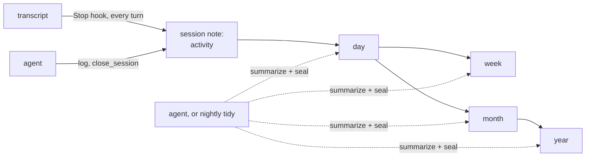

# Temporal Atlas

**Your coding agent forgets everything when the session ends. Temporal Atlas gives it a memory of past work, organized by time.**

Temporal Atlas is an MCP server. It records what you and your agents do in each session, then summarizes that record into day, week, month and year notes. Each layer is shorter than the one below it. When a new session starts, the agent already knows what happened yesterday, what was decided last week and which threads are still open. It can zoom into any period or search everything that came before.

The atlas is a folder of plain Markdown. Open it in Obsidian, edit it by hand, keep it in git. There is no database, no API key and no cloud service.

```
year      2026                    ~800 tokens    what the year was about
month     2026-10                 ~400 tokens    what shipped, what changed direction
week      2026-W42                ~500 tokens    the week's arc
day       2026-10-19              ~600 tokens    what got done, decided, left open
session   2026-10-19T0907-k3f9q2  full detail    requests, files, commits, decisions, findings
```

- Works with Claude Code, Codex, Cursor, Windsurf, VS Code and any other MCP client.
- In Claude Code and Codex, every session is recorded after each turn, without a model call and without the agent having to remember to do it.
- Search finds notes by keyword and by meaning, with a small embedding model that runs on your machine.
- Summaries are written by your agent, or overnight by `temporal-atlas tidy` with a hard token and dollar budget. The MCP server itself never calls a model.
- Every project gets its own memory. Client work can be isolated so no other project can see it.
- If you edit a note, your version wins, and the summaries built on it are redone.

## What your agent sees

At the start of every session the agent receives a brief of its project. This is a shortened example:

```markdown
# Atlas brief: billing-api
Today is Tue 2026-10-20, week 2026-W43. Days end at 04:00 local time.

## Last session (2026-10-19)
Moved invoice PDF rendering to a queue; retries now idempotent

#### Decisions
- Kept the existing S3 bucket; a new one would need a security review (2 weeks).
- Retry key is invoice_id + version, so a re-render after an edit is not deduplicated.

#### Open threads
- Load test with 10k invoices before Thursday's release.
- Ask Dana whether credit notes need the same queue.

## This week (draft)
- Mon 10-19: invoice rendering queue, idempotent retries
- Tue 10-20: (today)

## Last week: 2026-W42
Shipped proration for mid-cycle plan changes. Found and fixed a rounding bug in
EUR invoices (banker's rounding vs half-up). Decided to drop the legacy CSV export.

## Elsewhere this week
- **payments-gateway**: Stripe webhook signature check moved to middleware
```

When the agent needs more, it asks: "what did we decide about the CSV export?" runs `search`, and "what happened in September?" runs `zoom`. Search matches by meaning as well as by keyword, so "the spreadsheet download we removed" finds the note about the CSV export.

## Measured on real work

Numbers from the author's own atlas: 12 days of daily use (8 to 20 October 2026) across 11 scopes and 57 recorded conversations.

| | |
|---|---|
| Conversation text in those 57 conversations (tool output excluded) | about 1.25 million tokens |
| The same conversations as activity, recorded without a model | about 26,000 tokens, **49x smaller** |
| Activity per conversation per day | about 380 tokens |
| Raw transcripts on disk, for comparison | 300 MB |
| Sessions the agent summarized itself, against their conversation text | 36x smaller |
| Brief for the busiest project | about 1,600 tokens, built in under 100 ms |
| Model calls made by the MCP server | 0 |
| Day and week summaries written by `tidy` (Sonnet, 6 rollups) | 6 of 6 sealed, $0.13 in total, about 2 cents each |
| Test suite | 146 tests in about 6 seconds on macOS, Linux and Windows, none call a model |

Token counts are estimated at 4 characters per token, the same rule the server uses for its cost gate. Version 0.2 came out of these 12 days: see [what changed and why](DESIGN.md#18-what-v02-changed-and-why).

### Benchmark

`temporal-atlas bench` measures how well search and the brief bring back past work, without calling a model. `bench --fixture` runs a bundled atlas of 26 invented sessions and 33 questions, the same on every machine. Plain `bench` builds its questions from your own atlas, only reads it, and saves a report that holds numbers only. Results so far, and how to send yours, are in [BENCHMARK.md](BENCHMARK.md).

| Fixture, all 33 questions | hit@1 | hit@5 | MRR |
|---|---|---|---|
| 0.3.1: keyword search | 0.24 | 0.48 | 0.34 |
| 0.4.0: keyword and meaning | 0.48 | 0.67 | 0.57 |

## Quick start

Requires Node 20 or later and [Claude Code](https://claude.com/claude-code) or [Codex](https://developers.openai.com/codex).

```sh
npm install -g github:pomess/temporal-atlas
temporal-atlas setup
```

The package is installed straight from GitHub, with no npm registry involved.

`setup` shows what it will change, then asks three questions:

1. **Do you work for more than one client on this machine?** If yes (the default), every project starts isolated: no project's brief, search or index shows another's work.
2. **Write the summaries every night?** If yes, a launchd job runs `temporal-atlas tidy` at 04:30 with your Claude Code sign-in, and stops at $2.00 a night. If the computer is off or asleep at 04:30, the run happens at the next login or wake instead, once a day. On Linux and Windows, `setup` prints a crontab line or a Task Scheduler command for you to add. If no, your agent writes the summaries when you ask it to tidy the atlas.
3. **Download the search model?** If yes (the default), it fetches potion-base-8M (about 30 MB, MIT licence) from Hugging Face once, into `~/.cache/temporal-atlas/models`. Search then matches by meaning too. If no, search is keyword only until you run `temporal-atlas models pull`.

It then creates the atlas in `~/TemporalAtlas`, registers the MCP server with Claude Code for your user, and adds three hooks to `~/.claude/settings.json` (`SessionStart`, `Stop` after every turn, `SessionEnd`), keeping a backup of the file. Open a new Claude Code session in any project and the agent gets its brief.

If Codex is installed (its `~/.codex` folder exists), `setup` also adds the same three hooks to `~/.codex/hooks.json` and registers the server with `codex mcp add`. Codex runs new hooks only after you trust them: open Codex and run `/hooks` once. `temporal-atlas install codex` adds the Codex hooks on their own.

```sh
temporal-atlas doctor      # check the install and the backlog
temporal-atlas uninstall   # remove the hooks, the MCP server and the nightly run; your notes stay
```

`setup --yes` takes the defaults (isolated projects, no nightly run) without asking. `setup --dir <path>` puts the atlas somewhere else. To keep it inside an Obsidian vault, use a folder in the vault, such as `--dir ~/MyVault/Atlas`. The server writes only inside that folder.

### Other agents

Cursor, Windsurf, VS Code and other MCP clients can use every tool. They don't get automatic capture, so the atlas holds what the agent logs and summarizes. Create the atlas with `temporal-atlas init ~/TemporalAtlas`, then add the server:

```json
{
  "mcpServers": {
    "temporal-atlas": {
      "command": "temporal-atlas",
      "env": { "TEMPORAL_ATLAS_DIR": "/Users/you/TemporalAtlas" }
    }
  }
}
```

### Updating

Run the install command again. It replaces the code in place, and the hooks and the MCP server keep pointing at it:

```sh
npm install -g github:pomess/temporal-atlas          # latest
npm install -g github:pomess/temporal-atlas#v0.4.0   # a tagged version
```

From 0.3, run `temporal-atlas models pull` for search by meaning, and `temporal-atlas install codex` if you use Codex.

From 0.2, also run `temporal-atlas install claude-code` (hooks in the new format, which also works on Windows) and, if you use the nightly run, `temporal-atlas install nightly` (catches up after the computer was off). `doctor` tells you when either is needed.

From 0.1:

```sh
temporal-atlas install claude-code   # adds the Stop hook
temporal-atlas backfill --dry-run    # shows what it would record, then run it without --dry-run
temporal-atlas tidy --dry-run        # shows the backlog and its size
```

`backfill` builds activity for older sessions from their transcripts, folds the notes of a reopened conversation into one, and skips headless runs. It uses no model.

### Install from source

```sh
git clone https://github.com/pomess/temporal-atlas.git && cd temporal-atlas
npm install
node dist/cli/main.js setup
```

Run `npm run compile` after you change the code. The server and the hooks run whatever is in `dist/`.

## How it works



**Activity.** After every turn, the `Stop` hook (in Claude Code or Codex) reads what the transcript gained and writes an `### Activity` section into the session note: the session title, what you asked, the files changed, commits, pushes and PRs, and where the agent left off. No model is involved and it takes milliseconds, because only the new part of the transcript is read. Tool output is never copied. A conversation you reopen or resume keeps writing to the same note.

```markdown
### Activity
Invoice PDF rendering queue

- 09:07 asked: Move invoice PDF rendering off the request path, it times out on big invoices
- 10:31 asked: make the retries idempotent
- 11:02 asked: commit and push
- files changed (3): `src/render/queue.ts`, `src/render/worker.ts`, `test/render.test.ts`
- 11:02 commit: Render invoice PDFs from a queue with idempotent retries
- 11:03 pushed (origin main)
- 11:04 last reply: Pushed. Rendering runs on the queue now; a retry with the same invoice_id and version is a no-op...
- 3 requests, 41 tool calls
```

**Events and summaries.** As it works, the agent can also call `log` for each decision (with the reason), notable change, finding or todo. Before it finishes, it calls `close_session` with a headline and a summary. These carry the why, which activity cannot. A session that runs past the day boundary (04:00 by default) is split into one segment per day, so late-night work counts toward the day it belongs to.

**Drafts.** While a period is open, its note is a draft that the server assembles from the notes beneath it. Drafts cost no tokens and show in Obsidian as they grow.

**Rollups and sealing.** Once a period ends, it becomes a pending rollup. Someone reads its sources, writes a summary to a length target, and seals it: your agent through the `summarize` and `seal` tools, or `temporal-atlas tidy`. The server rejects a summary longer than 150% of its target. Days roll up into both weeks and months, because ISO weeks cross month boundaries. Months roll up into years.

**Nightly runs.** `install nightly` schedules `tidy --scheduled` at 04:30, at login and every hour. Only the first of those in an atlas day does anything, so a laptop that was shut down overnight catches up when you log in, and the other runs exit at once. A run that could not reach the model, because you were offline or signed out, is tried again the next hour. `doctor` warns if the schedule has never run, or has not run for a day and a half.

**Cost control.** The server estimates the input tokens of every pending rollup. An agent runs rollups under the cost gate (30,000 tokens by default) without asking, and must tell you the estimate and wait for your yes above it. `tidy` runs inside its own token and dollar budget instead, passes the remaining dollar budget to every `claude` call, and logs each rollup with its cost to `.atlas/tidy.log`. Two writers cannot summarize the same period at once. A lock file blocks the second one for up to 30 minutes.

**Topics.** Durable knowledge, such as "Auth design" or "Pricing model", lives in topic notes. Each one has the current state on top and a dated timeline below. Before creating a topic, the server checks for existing ones with similar names, so you don't end up with "Auth", "Authentication" and "Auth design".

### What is not recorded

- Headless sessions: `claude -p` runs and other sessions where every prompt came from a program. These are usually tools calling a model, and recording them filled v0.1 with noise. Set `capture.headless` to record them.
- Sessions in folders listed in `capture.ignorePaths`.
- The `claude -p` calls that `tidy` makes.

### Projects and client isolation

Every session belongs to a scope, usually one project or one client. The server picks the scope in this order:

1. A rule you saved with `scopes` (`mapHere`) for this folder or git remote.
2. `general`, for folders inside `capture.generalPaths`, such as the scratch folders Claude Desktop creates for each chat.
3. The repository name from the `origin` git remote.
4. The git root folder name.
5. The working directory name.
6. `general`, for sessions outside any project (including your home directory).

A scope marked isolated is visible only from sessions inside it. It never appears in another project's brief, in search results or in index notes, even if an agent asks for it by name. With `isolateNewScopes` on (the `setup` default), every new project starts isolated. Use `scopes` to open one up, for example a personal project you want to see from everywhere.

| From a session in | Can read |
|---|---|
| an isolated scope X | X and `general` |
| any other scope | itself, `general`, every non-isolated scope, index notes |

A scope follows the folder you start in, not the client you work for. If you prepare one client's workshop from another project's folder, tell the agent ("this is client-x work") and it calls `log` with that scope. The session note moves to client-x, and the hooks keep writing there. Sessions in your home folder or in app scratch folders go to `general`, which every scope can read, so keep client work inside its project folder.

`scopes` can also merge one scope into another. Merging into an unused name is a rename.

### Your edits win

The server stores a hash of every note body it writes. If the body on disk no longer matches, a person edited it. The server keeps that version, never overwrites it, and marks every summary built on it stale. Stale summaries go back into the rollup queue.

Agents correct sealed notes with `amend`. An amendment adds a dated entry with its reason and leaves the original text in place.

### Privacy and security

- The atlas stays on your disk. The MCP server and the hooks make no network calls. `tidy` sends rollup sources to the model through your own `claude` CLI, only when you run or schedule it.
- The search model is downloaded once, by `setup` when you agree or by `temporal-atlas models pull`, from a pinned Hugging Face revision whose file hashes are checked. It runs on your machine; search sends nothing anywhere.
- `bench` only reads the atlas. Its report holds numbers, the version, the platform and the model id: no note text, no project or note names. `bench --paraphrase` sends the probe queries (one clause of a logged event, or a summary headline) to a model through your `claude` CLI, after asking.
- Before writing any note, the server replaces likely secrets with `[redacted:<kind>]`. The built-in patterns cover Anthropic, OpenAI, GitHub, Slack and AWS keys, bearer tokens, private key blocks, passwords in connection strings and `secret=`-style assignments. You can add your own.
- Activity keeps short excerpts of requests and replies (300 and 600 characters at most), never tool output. Full conversation text goes to a model only if you summarize an orphan session from its transcript (`tidy --orphans`, or an agent asked to).

## Things to ask your agent

| You say | The agent calls |
|---|---|
| "What were we doing on this?" | `brief` |
| "What did we decide about the CSV export?" | `search` |
| "Show me what happened in September." | `zoom` with `2026-09` |
| "Tidy the atlas." | `pending`, then `summarize` and `seal` for each rollup |
| "Keep this project hidden from the others." | `scopes` with `isolated` |
| "Sessions in this folder belong to billing-api." | `scopes` with `mapHere` |
| "This session is client-x work." | `log` with `scope: "client-x"`, which moves the session |
| "That summary is wrong, we never dropped the export." | `amend` |
| "What do we know about auth?" | `topic` |

## Tools

| Tool | Arguments | Does |
|---|---|---|
| `brief` | `scope?`, `lookback?` | The layered view of recent work in a scope |
| `log` | `type`, `text`, `topics?`, `scope?` | Records a decision, change, finding, todo or note |
| `close_session` | `headline`, `summary`, `segment?` | Writes the session summary and returns pending rollups |
| `pending` | `all?` | Lists pending rollups with token estimates, each marked `auto` or `needs_confirmation` |
| `summarize` | `period`, `scope?`, `confirmed?` | Returns the sources, length target and instructions for one rollup |
| `seal` | `period`, `content`, `headline`, `scope?`, `topic_updates?` | Saves a rollup and seals the period |
| `zoom` | `period`, `scope?` | Opens a period or session and lists the notes beneath it |
| `search` | `query`, `scope?`, `layer?`, `from?`, `to?` | Search by keyword (BM25) and by meaning, filtered by scope, layer and date. Each result says how it matched. |
| `topic` | `name`, `scope?`, `update?`, `force?` | Reads, creates or updates a topic note |
| `scopes` | `set?` | Lists scopes, or isolates, maps or merges one |
| `amend` | `note`, `change`, `reason` | Adds a dated correction to a sealed note |

The server uses only tools, no MCP resources or prompts, so it behaves the same in every client. Clients that don't read server instructions, such as VS Code Copilot, can call `brief` to get the same context.

## Command line

```
temporal-atlas                      Run the MCP server over stdio
temporal-atlas setup                Set up everything for Claude Code (asks first; --dir, --isolate, --no-isolate, --nightly, --yes)
temporal-atlas uninstall            Remove the hooks, the MCP registration and the nightly run; keeps your notes
temporal-atlas init [dir]           Create an atlas (default: $TEMPORAL_ATLAS_DIR or ~/TemporalAtlas)
temporal-atlas install claude-code  Add the capture hooks to ~/.claude/settings.json (asks first; --yes to skip)
temporal-atlas install codex        Add the capture hooks to ~/.codex/hooks.json (asks first; --yes to skip)
temporal-atlas install nightly      Schedule `tidy --scheduled` every night, catching up after the computer was off
                                      (asks first; --at HH:MM, --remove)
temporal-atlas tidy                 Write pending rollups with `claude -p`, within a token and dollar budget
                                      --dry-run, --yes, --scheduled, --scope <name>, --model <name>,
                                      --max-tokens <n>, --max-usd <amount>, --orphans
temporal-atlas backfill             Record older sessions from their transcripts, without a model
                                      --dry-run, --prune (delete headless runs instead of marking them)
temporal-atlas models pull          Download the search model (potion-base-8M, about 30 MB, once)
temporal-atlas models status        Show whether the search model is installed
temporal-atlas bench                Score search and the brief on your atlas (read only, no model; saves a numbers-only report)
                                      --fixture, --json, --out <file>, --max <n>, --sweep,
                                      --paraphrase (paid, asks first; --model <name>, --max-usd <amount>)
temporal-atlas doctor               Check the atlas: backlog, unrecorded sessions, hooks, search model, broken notes
temporal-atlas hook <event>         Called by the hooks; not for direct use

Every command takes --dir <path> for the atlas folder instead of $TEMPORAL_ATLAS_DIR.
Models are kept in $TEMPORAL_ATLAS_MODELS, default ~/.cache/temporal-atlas/models.
```

A `tidy --dry-run` prints the plan before anything is spent:

```
[2026-10-20T17:35:17+02:00] 46 rollup(s) pending, about 63682 input tokens.
Budget for this run: 200000 tokens or $2.00, model sonnet.
  billing-api 2026-10-14 (day, about 1576 tokens)
  payments-gateway 2026-10-14 (day, about 940 tokens)
  ...
```

## Configuration

`TEMPORAL_ATLAS_DIR` sets the atlas folder. The default is `~/TemporalAtlas`.

`atlas.config.json` in the atlas folder holds everything else. Every key is optional.

```json
{
  "timezone": "local",
  "dayBoundary": "04:00",
  "costGateTokens": 30000,
  "lengthTargets": { "segment": 1500, "day": 600, "week": 500, "month": 400, "year": 800 },
  "briefTokens": { "instructions": 1500, "tool": 5000 },
  "scrubPatterns": [{ "name": "internal-token", "pattern": "itk_[A-Za-z0-9]{32}" }],
  "rollups": "agent",
  "isolateNewScopes": true,
  "capture": {
    "headless": false,
    "ignorePaths": ["~/scratch"],
    "generalPaths": ["~/Library/Application Support/Claude", "~/.config/Claude", "~/AppData/Roaming/Claude"]
  },
  "tidy": { "command": "claude", "model": "sonnet", "maxTokens": 200000, "maxUsd": 2, "at": "04:30" },
  "semanticSearch": true
}
```

| Key | Meaning |
|---|---|
| `timezone` | An IANA zone such as `Europe/Madrid`, or `local` for the system zone |
| `dayBoundary` | When one day ends and the next begins. Work at 01:30 counts toward the previous day. |
| `costGateTokens` | Agent rollups above this running total need your confirmation |
| `lengthTargets` | Target size in tokens for each layer's notes |
| `briefTokens` | Cap for the brief in the server instructions and for the `brief` tool |
| `scrubPatterns` | Extra secret patterns, as regular expressions |
| `rollups` | `agent`: the agent is asked to do rollups. `nightly`: agents are told the nightly run does them. Set by `install nightly`. |
| `isolateNewScopes` | Every new project starts isolated. On by default when you answer yes in `setup`. |
| `capture.headless` | Also record `claude -p` and other program-driven sessions |
| `capture.ignorePaths` | Folders the hooks never record |
| `capture.generalPaths` | Folders whose sessions go to the `general` scope |
| `tidy.command` | The Claude Code CLI to run |
| `tidy.model` | Model for tidy runs. `haiku` costs less, `sonnet` writes better summaries. |
| `tidy.maxTokens`, `tidy.maxUsd` | A tidy run stops before passing either |
| `tidy.at` | Local time for `install nightly`. A computer that is off then catches up at the next login. |
| `semanticSearch` | Match by meaning as well as keyword when the search model is installed. `false` keeps search keyword only. |
| `transcriptMaxChars` | Transcript text handed to an orphan rollup is cut to this length (default 160,000) |

## What's on disk

```
TemporalAtlas/
  atlas.config.json
  scopes/
    billing-api/
      sessions/2026/10/2026-10-19T0907-k3f9q2.md
      days/2026/2026-10-19 billing-api.md
      weeks/2026/2026-W43 billing-api.md
      months/2026/2026-10 billing-api.md
      years/2026 billing-api.md
      topics/Invoice rendering.md
  index/days|weeks|months|years/     every non-isolated project's headline per period
  .atlas/                            scope rules, session registry, capture progress, locks, tidy.log
```

Every note has YAML frontmatter (`layer`, `period`, `scope`, `status`, `headline`, `sources`) and links its sources with `[[wikilinks]]`, so Obsidian's graph and backlinks work without setup. Week files use the ISO week-numbering year, so 29 December 2025 belongs to `2026-W01`.

## Limits

- Windows: the hooks and the server are written to work there, and the test suite runs on Windows in CI, but day-to-day use so far has been on macOS. The nightly run needs the Task Scheduler command that `install nightly` prints.
- Automatic activity capture exists for Claude Code and Codex. In other clients, the atlas records what the agent logs and summarizes through the tools.
- Codex does not tell its MCP servers which conversation they serve. The server joins the Codex conversation that started in the same folder within five minutes, so two Codex conversations started together in one folder can swap notes.
- Activity says what was asked and changed, not why. The why comes from the agent's `log` events and summaries.
- Rollups need a writer: your agent, or `tidy`. Until a period is sealed, the brief shows its draft.
- Each `tidy` rollup is one `claude -p` call, about 20 seconds each, so a large backlog takes a while. The nightly budget spreads it over several nights.
- The search model is small (8 million parameters, English) so that it runs anywhere without native code. On the fixture it finds a paraphrased question's note in the top five 58% of the time, against 39% for keyword search alone.
- Search reads the files on every call and keeps embeddings in memory, so the first search in a session takes longer (about 60 ms more for 250 notes).
- The brief shows only the last session's open threads. Todos logged in earlier sessions don't appear (the benchmark scores this at 0%).

## Development

```sh
npm install
npm test           # unit and integration tests; none call a model
npm run typecheck
npm run compile    # rebuilds dist/, which is committed
```

Tests use a fake clock, so they cover day boundaries, ISO weeks at year ends and sessions that span several days without waiting. Integration tests start the real server and drive it through the MCP SDK client. `tidy` is tested with a fake model and a fake `claude` executable.

Read [DESIGN.md](DESIGN.md) for the full design, [CONTEXT.md](CONTEXT.md) for the vocabulary, [docs/adr/](docs/adr/) for the decisions behind it, and [CONTRIBUTING.md](CONTRIBUTING.md) before sending a change. Changes are listed in [CHANGELOG.md](CHANGELOG.md).

## License

MIT. Built by Bruno Manzano. The search model, [potion-base-8M](https://huggingface.co/minishlab/potion-base-8M) by Minish Lab, is MIT licensed and is downloaded separately, not bundled.
